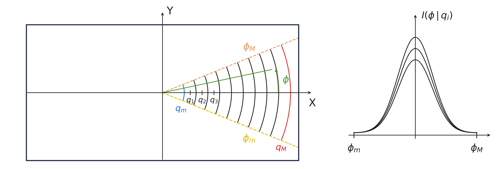
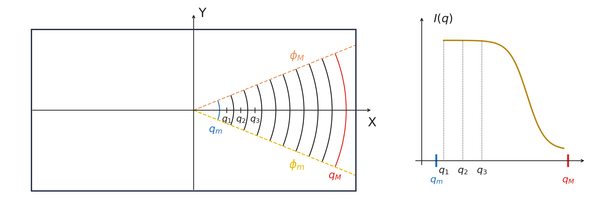
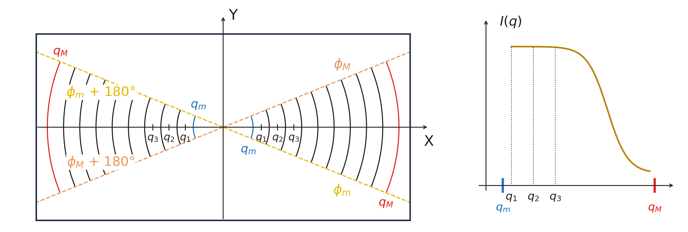
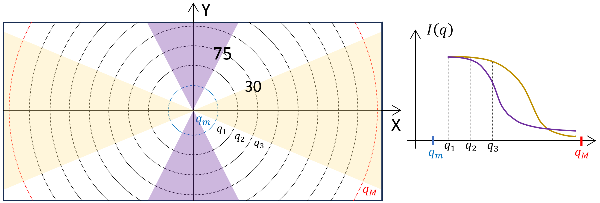
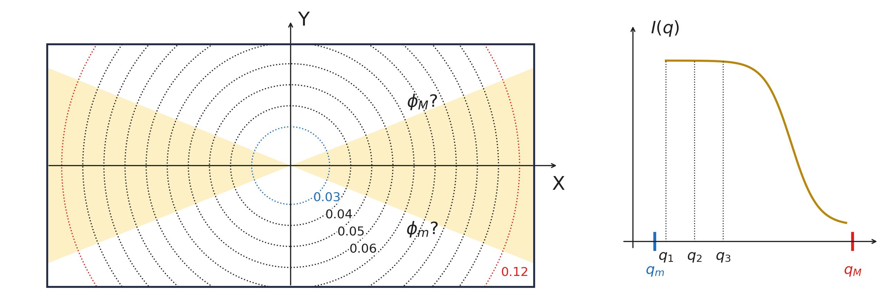
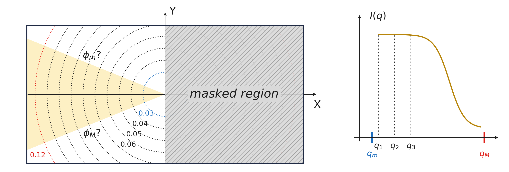
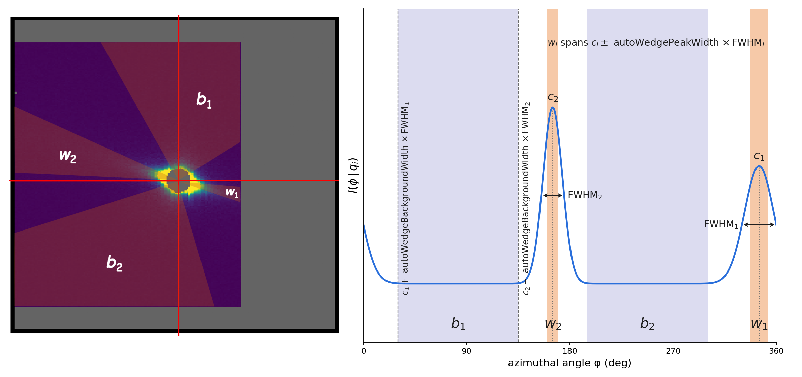
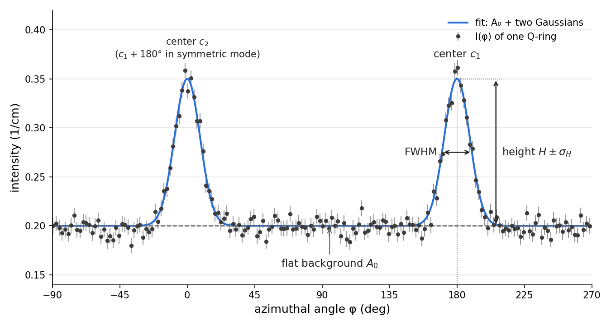

.. _user.binning:

Binning
=======

.. contents:: Contents
   :local:

Scalar Binning
--------------

Scalar or azimuthal binning produces a one dimensional intensity profile :math:`I(Q)` from
:math:`I(x,y,\lambda)`.

.. code-block:: json

    {
      "1DQbinType": "scalar",
      "QbinType": "linear",
      "numQBins": 200,
      "Qmin": 0.003,
      "Qmax": 0.005
    }

Wedge Binning
-------------

In Small-Angle Neutron Scattering (SANS), wedge binning is a data analysis technique used to enhance
the signal-to-noise ratio by collecting data over specific angular sectors, or "wedges," of the detector.
This method is particularly useful when the scattering pattern exhibits anisotropy due to preferred
directions in the sample structure.

After obtaining intensity :math:`I(q_x, q_y)` in the detector plane, we can rebin the intensity in
"polar" coordinates :math:`I(q, \phi)`, where :math:`q = \sqrt{q_x^2 + q_y^2}` is the magnitude of the
scattering vector and :math:`\phi = \arctan(q_y/q_x)` is the azimuthal angle. The intensity is then
binned into :math:`q`-bins of constant width.

Most typical is to integrate :math:`I(q, \phi)` over the azimuthal angle :math:`\phi` between
limits :math:`\phi_m` and :math:`\phi_M` defining a wedge, yielding the :math:`I(q)`
representative of the feature captured in the wedge region.

The feature is achiral so the intensity profile is symmetric with respect to the beam center,
:math:`I(-q_x, -q_y) = I(q_x, q_y)` or :math:`I(q, \phi + \pi) = I(q, \phi)`. The symmetric wedge is
therefore the wedge rotated by 180 degrees.
The intensity profile is then binned within the region defined by the two symmetric wedges:

`drtsans` provides a function to perform wedge binning on the detector plane. User can specify the
the azimuthal limits for one or more wedges. For instance, the two wedges
:math:`(-30, 30)` and :math:`(75, 105)` can be specified as:

.. code-block:: json

    {
      "WedgeMinAngles": [-30, 75],
      "WedgeMaxAngles": [ 30, 105]
    }

`drtsans` **assumes achiral features** so the wedges symmetric to these two wedges are included in the binning.

.. _user.binning.auto_wedge:

Automatic Finding of the Wedge
+++++++++++++++++++++++++++++++

If User wants `drtsans` to automatically find the azimuthal limits for wedge binning, there are
options to specify. For instance, we want the resulting :math:`I(q)` from :math:`q_{min}=0.03 A^{-1}`
to :math:`q_{max}=0.12 A^{-1}` in bins of width :math:`\delta q=0.01 A^{-1}`.
In this example the anisotropy lies along the :math:`X`-axis, so `drtsans` finds one wedge along that
axis, along with its symmetric counterpart. The algorithm itself is not restricted to any orientation.

.. code-block:: json

    {
      "autoWedgeQmin": 0.03,
      "autoWedgeQmax": 0.12,
      "autoWedgeQdelta": 0.01
    }

User may define a single azimuthal range for the automatic finding of the wedge.
User can provide negative values for the azimuthal range, for instance, :math:`(-90, -30)`, with the understanding
that the range is interpreted as :math:`(270, 330)`.
Once the `autoWedgePhiMin` and `autoWedgePhiMax` range is provided,
the search for the wedge begins at the midpoint of the range, and is initially constrained to half the range
around this midpoint.

For instance, in the BIOSANS instrument the area in the main detector defined by the azimuthal range
:math:`(-90, 90)` is partially occluded by the Wing detector,
because the Wing detector is positioned closer to the sample than the main detector.
User can request finding the wedge in the azimuthal range :math:`(90, 270)` free from occlusion, and then
automatically include the symmetric wedge in the binning.
The range :math:`(-90, 90)` is effectively masked during the wedge search.

.. code-block:: json

    {
      "autoWedgeQmin": 0.03,
      "autoWedgeQmax": 0.12,
      "autoWedgeQdelta": 0.01,
      "autoWedgePhiMin": 90,
      "autoWedgePhiMax": 270,
      "autoSymmetricWedges": true
    }

Other additional options for the automatic wedge finding:

- `autoWedgeAzimuthalDelta`: binning in azimuthal angle when generating the :math:`I(\phi)` profile.
- `autoWedgePeakWidth`: fraction of the full-width-half-max (FWHM) of the fitted peak in the :math:`I(\phi)`
  profile. Each peak wedge spans the peak center :math:`\pm` `autoWedgePeakWidth` :math:`\times` FWHM.
- `autoWedgeBackgroundWidth`: fraction of the FWHM of the fitted peak that sets the edges of the background
  wedges. The background wedges are perpendicular to the peaks and give the second :math:`I(q)` output; they are
  not subtracted from the peak wedges.
  Each background wedge lies between the two peaks, from `autoWedgeBackgroundWidth` :math:`\times` FWHM past one
  peak to `autoWedgeBackgroundWidth` :math:`\times` FWHM before the other. When the peaks are so wide that
  `autoWedgeBackgroundWidth` :math:`\times (\mathrm{FWHM}_1 + \mathrm{FWHM}_2)` reaches the separation :math:`S`
  of the two peak centers (about 180 degrees), the background wedges would be empty. The reduction then uses
  :math:`S / (\mathrm{FWHM}_1 + \mathrm{FWHM}_2) -` `autoWedgePeakWidth` instead, which makes each background
  wedge about as wide as the peak wedges, and logs a warning with the requested and the applied values.
  For example, peaks with a FWHM of 95 degrees reduce the default 1.5 to about 0.70. If the peaks leave no room for a
  background wedge at all, the automatic wedge detection fails with a message suggesting a narrower Q range or
  manual wedges.

For instance, for real data collected at the BIOSANS instrument,

.. code-block:: json

    {
      "autoWedgeQmin": 0.0,
      "autoWedgeQmax": 0.02,
      "autoWedgeQdelta": 0.001,
      "autoWedgeAzimuthalDelta": 1.0,
      "autoWedgePeakWidth": 0.25,
      "autoWedgeBackgroundWidth": 1.5
    }

We obtain two wedges (:math:`w_1`, :math:`w_2`) as well as two azimuthal ranges (:math:`b_1`, :math:`b_2`)
perpendicular to them, which give the background :math:`I(q)` output.

.. _user.binning.auto_wedge_method:

How Automatic Wedge Finding Works
+++++++++++++++++++++++++++++++++

Automatic wedge finding fits the azimuthal profile of several :math:`q` rings, decides which rings show the
anisotropy of the sample, and builds the wedges from the peaks of those rings.

Q-rings and azimuthal profiles
~~~~~~~~~~~~~~~~~~~~~~~~~~~~~~

The :math:`q` range from `autoWedgeQmin` to `autoWedgeQmax` is divided into rings of width `autoWedgeQdelta`.
The intensity of each ring is binned in azimuthal angle :math:`\phi` with bins of `autoWedgeAzimuthalDelta`
degrees, which gives one profile :math:`I(\phi)` per ring.

Fit model
~~~~~~~~~

Each profile is fitted with a flat background plus two Gaussian peaks:

.. math::

   I(\phi) = A_0 + \sum_{i=1}^{2} H_i \exp\left[-\frac{(\phi - c_i)^2}{2 \sigma_i^2}\right],
   \qquad \mathrm{FWHM}_i = 2\sqrt{2 \ln 2}\, \sigma_i

The fit returns the background :math:`A_0` and, for each peak, the height :math:`H` with its uncertainty
:math:`\sigma_H`, the center :math:`c` and the FWHM. With `autoSymmetricWedges`, the second peak is the mirror of
the first: same height and width, with :math:`c_2 = c_1 + 180°`. Only the first peak is then evaluated.

   Fictitious :math:`I(\phi)` profile of one :math:`q` ring, with the fitted model and its parameters.

Seed criteria
~~~~~~~~~~~~~

A ring is a seed candidate when its fit has :math:`\chi^2 \le 1000` and each peak satisfies:

- **Contrast** :math:`H/A_0 \ge` `autoWedgeContrastMin`, with :math:`A_0 > 0`. The contrast measures how much the
  peak stands out from the isotropic scattering. It does not change with counting time, so it separates real
  anisotropy from weak systematic structure, such as detector artifacts, at any statistics.
- **Significance** :math:`H/\sigma_H \ge` `autoWedgeSignalToNoiseMin`. The significance ensures that the peak is
  not a statistical fluctuation. It grows as the square root of the counts for real peaks and for systematic
  artifacts alike, which is why it is combined with the contrast rather than used alone.
- **Width** :math:`3 \times` `autoWedgeAzimuthalDelta` :math:`\le \mathrm{FWHM} \le 180°`. A narrower peak is not
  resolved by the azimuthal bins, and a wider peak cannot be separated from its partner 180° away.

Consensus orientation
~~~~~~~~~~~~~~~~~~~~~

Rings without anisotropy can still produce fits that pass the seed criteria, at an unrelated
orientation. The seed candidates are therefore grouped by orientation. Starting from the strongest ring, each
candidate joins the first group whose peak centers it matches within `autoWedgeCenterTolerance`
:math:`\times` FWHM, or starts a new group. Each ring weighs :math:`\sum 1/\sigma_c` over its peaks, where
:math:`\sigma_c` is the uncertainty of a peak center, and angles are compared on the circle, so that 359° and 1°
are 2° apart.

The group with the largest weight is the consensus if it holds at least 67% of the weight of all candidates.
Its rings become **seed** rings. Candidates in other groups are marked **inconsistent**. If no group reaches 67%,
the rings disagree on the orientation and the wedge finding fails.

Rescue of weaker rings
~~~~~~~~~~~~~~~~~~~~~~

A ring that fails the seed criteria, for instance because its contrast is low, is **rescued** if each of its peak
centers lies within `autoWedgeCenterTolerance` :math:`\times` FWHM of the consensus, its fit has
:math:`\chi^2 \le 1000`, and each peak has a valid width and :math:`H/\sigma_H \ge \min(5, N)`, where :math:`N` is
`autoWedgeSignalToNoiseMin`. Contrast is not required, since agreement with the consensus already excludes artifacts at other
orientations. Other rings are **rejected**, and rings whose fit did not converge are marked **fit failed**.

The seed and rescued rings are the accepted rings. Their peak centers and FWHMs, averaged with the same weights,
determine the wedges.

Wedge JSON Settings
+++++++++++++++++++

This section lists the settings of manual and automatic wedge reduction. The quantities used by the automatic
settings, such as the peak height :math:`H`, the background :math:`A_0` and the FWHM, are defined in
:ref:`user.binning.auto_wedge_method`.

Wedge reduction is enabled by selecting wedge binning for the 1D output:

.. code-block:: json

    {
      "1DQbinType": "wedge"
    }

The wedge angles can be provided manually with ``WedgeMinAngles`` and ``WedgeMaxAngles``,
or they can be found automatically from an azimuthal intensity profile, :math:`I(\phi)`.
Manual wedge definitions take precedence when ``WedgeMinAngles`` and ``WedgeMaxAngles``
are non-empty. Automatic wedge finding is used when ``1DQbinType`` is ``"wedge"`` and
the manual wedge angle lists are not supplied by the reduction input. Use ``null`` for
unset manual wedge angles with BIOSANS and GPSANS. Use empty lists, ``[]``, with EQSANS.

.. list-table::
   :header-rows: 1
   :widths: 24 18 58

   * - Setting
     - Used for
     - Meaning
   * - ``1DQbinType``
     - Manual and automatic
     - Selects the 1D binning mode. Use ``"wedge"`` to output one :math:`I(q)` profile per wedge group.
   * - ``QbinType``
     - Manual and automatic
     - Selects linear or logarithmic :math:`q` bins for the wedge :math:`I(q)` output.
   * - ``numQBins`` or instrument-specific ``num*QBins``
     - Manual and automatic
     - Number of :math:`q` bins when ``QbinType`` is ``"linear"``. For BIOSANS, use the detector-specific settings such as ``numMainQBins`` and ``numWingQBins``.
   * - ``LogQBinsPerDecade`` or instrument-specific ``LogQBinsPerDecade*``
     - Manual and automatic
     - Number of :math:`q` bins per decade when ``QbinType`` is ``"log"``.
   * - ``Qmin`` / ``Qmax`` or detector-specific ``Qmin*`` / ``Qmax*``
     - Manual and automatic
     - Optional :math:`q` range for the final wedge :math:`I(q)` output. BIOSANS uses detector-specific ranges such as ``QminMain`` and ``QmaxWing``.
   * - ``WedgeMinAngles``
     - Manual
     - List of lower azimuthal-angle bounds in degrees. Values are in the range ``[-90, 270)``.
   * - ``WedgeMaxAngles``
     - Manual
     - List of upper azimuthal-angle bounds in degrees. This list must have the same length as ``WedgeMinAngles``.
   * - ``autoWedgeQmin``
     - Automatic
     - Minimum :math:`q` value used to build the :math:`I(\phi)` profiles for wedge finding.
   * - ``autoWedgeQmax``
     - Automatic
     - Maximum :math:`q` value used to build the :math:`I(\phi)` profiles for wedge finding.
   * - ``autoWedgeQdelta``
     - Automatic
     - Width of each :math:`q` ring used during automatic wedge finding.
   * - ``autoWedgeAzimuthalDelta``
     - Automatic
     - Azimuthal bin width, in degrees, used to build each :math:`I(\phi)` profile.
   * - ``autoWedgePeakWidth``
     - Automatic
     - Half-width of each peak wedge, as a fraction of the full-width-half-maximum (FWHM) of the fitted peak.
       The peak wedge spans the peak center :math:`\pm` ``autoWedgePeakWidth`` :math:`\times` FWHM. Default 0.25.
   * - ``autoWedgeBackgroundWidth``
     - Automatic
     - Distance from each peak center to the edges of the background wedges, which lie between the peaks, as a
       fraction of the FWHM of the fitted peak. If the peaks are too wide for this value, it is reduced
       automatically, with a warning in the log (see :ref:`user.binning.auto_wedge`). Default 1.5.
   * - ``autoWedgeSignalToNoiseMin``
     - Automatic
     - Minimum significance :math:`H/\sigma_H` (fitted peak height over its uncertainty) of each peak for a
       :math:`q` ring to seed the wedge orientation. Default 10. In earlier versions, this key set a threshold on the
       ratio of the mean to the minimum of :math:`I(\phi)`; a value kept in an existing JSON file is now read as
       a significance.
   * - ``autoWedgeContrastMin``
     - Automatic
     - Minimum contrast :math:`H/A_0` (fitted peak height over the flat background) of each peak for a
       :math:`q` ring to seed the wedge orientation. Default 0.2.
   * - ``autoWedgeCenterTolerance``
     - Automatic
     - Maximum deviation of a peak center from the orientation shared by the seed rings, as a fraction of the
       FWHM of the peak, in :math:`(0, 1]`. Default 0.5.
   * - ``autoWedgePhiMin`` / ``autoWedgePhiMax``
     - Automatic
     - Optional azimuthal search range, in degrees. This is useful when part of the detector should be excluded from the search.
   * - ``autoSymmetricWedges``
     - Automatic
     - If ``true``, find the wedge only inside the requested azimuthal search range, then add its symmetric counterpart.
   * - ``autoWedgePeakSearchWindowSizeFactor``
     - Automatic
     - Optional peak-search window scale used by GPSANS automatic wedge finding.
   * - ``wedge1Qmin*`` / ``wedge1Qmax*`` and ``wedge2Qmin*`` / ``wedge2Qmax*``
     - BIOSANS
     - Detector-specific :math:`q` ranges for BIOSANS wedge 1 and wedge 2 outputs. Suffixes include ``Main``, ``Wing``, and ``Midrange``.
   * - ``wedge1overlapStitchQmin`` / ``wedge1overlapStitchQmax`` and ``wedge2overlapStitchQmin`` / ``wedge2overlapStitchQmax``
     - BIOSANS
     - Wedge-specific overlap ranges used when stitching BIOSANS detector panels.

Wedge Reduction Examples
++++++++++++++++++++++++

A manual wedge reduction specifies the wedge angles directly. The following example produces
two wedge :math:`I(q)` profiles, one for :math:`(-30, 30)` degrees and one for
:math:`(75, 105)` degrees. Because ``drtsans`` assumes achiral features for manual wedges,
the corresponding symmetric wedges are included in each profile.

.. code-block:: json

    {
      "configuration": {
        "1DQbinType": "wedge",
        "QbinType": "log",
        "LogQBinsPerDecade": 25,
        "WedgeMinAngles": [-30, 75],
        "WedgeMaxAngles": [30, 105]
      }
    }

An automatic wedge reduction leaves the manual wedge angle lists unset and provides the
:math:`q` range and binning used to build the azimuthal profiles. The reduction finds the
wedge angles from the peaks in :math:`I(\phi)` and stores the resulting wedge selections in
the reduction output. For BIOSANS and GPSANS, use ``null`` for the unset manual wedge
angles:

.. code-block:: json

    {
      "configuration": {
        "1DQbinType": "wedge",
        "QbinType": "log",
        "LogQBinsPerDecade": 25,
        "WedgeMinAngles": null,
        "WedgeMaxAngles": null,
        "autoWedgeQmin": 0.003,
        "autoWedgeQmax": 0.04,
        "autoWedgeQdelta": 0.01,
        "autoWedgeAzimuthalDelta": 1.0,
        "autoWedgePeakWidth": 0.25,
        "autoWedgeBackgroundWidth": 1.5,
        "autoWedgeSignalToNoiseMin": 10.0,
        "autoWedgeContrastMin": 0.2,
        "autoWedgeCenterTolerance": 0.5
      }
    }

For EQSANS, use empty manual wedge angle lists instead:

.. code-block:: json

    {
      "configuration": {
        "1DQbinType": "wedge",
        "QbinType": "log",
        "LogQBinsPerDecade": 25,
        "WedgeMinAngles": [],
        "WedgeMaxAngles": [],
        "autoWedgeQmin": 0.003,
        "autoWedgeQmax": 0.04,
        "autoWedgeQdelta": 0.01,
        "autoWedgeAzimuthalDelta": 1.0,
        "autoWedgePeakWidth": 0.25,
        "autoWedgeBackgroundWidth": 1.5,
        "autoWedgeSignalToNoiseMin": 10.0,
        "autoWedgeContrastMin": 0.2,
        "autoWedgeCenterTolerance": 0.5
      }
    }

For BIOSANS, wedge reduction commonly also sets detector-specific :math:`q` ranges and
overlap stitching ranges for each wedge:

.. code-block:: json

    {
      "configuration": {
        "1DQbinType": "wedge",
        "QbinType": "log",
        "numMainQBins": 33,
        "numWingQBins": 33,
        "numMidrangeQBins": 33,
        "LogQBinsPerDecadeMain": null,
        "LogQBinsPerDecadeWing": null,
        "LogQBinsPerDecadeMidrange": null,
        "WedgeMinAngles": [-30, 60],
        "WedgeMaxAngles": [30, 120],
        "wedge1QminMain": 0.02,
        "wedge1QmaxMain": 0.09,
        "wedge1QminWing": 0.08,
        "wedge1QmaxWing": 0.09,
        "wedge1QminMidrange": 0.04,
        "wedge1QmaxMidrange": 0.05,
        "wedge1overlapStitchQmin": 0.0825,
        "wedge1overlapStitchQmax": 0.0875,
        "wedge2QminMain": 0.02,
        "wedge2QmaxMain": 0.125,
        "wedge2QminWing": 0.06,
        "wedge2QmaxWing": 1.0,
        "wedge2QminMidrange": 0.05,
        "wedge2QmaxMidrange": 0.7,
        "wedge2overlapStitchQmin": 0.075,
        "wedge2overlapStitchQmax": 0.095
      }
    }

Annular Binning
---------------

Annular binning produces a one dimensional intensity profile, :math:`I(\phi)`, which gives intensity
as a function of the angle around the beam center, :math:`\phi`, over a limited range of scalar
:math:`Q`. Annular binning uses linear spacing in :math:`\phi` with a default bin size of 1 degree.

.. code-block:: json

    {
      "1DQbinType": "annular",
      "AnnularAngleBin": 1.0,
      "Qmin": 0.003,
      "Qmax": 0.005
    }
