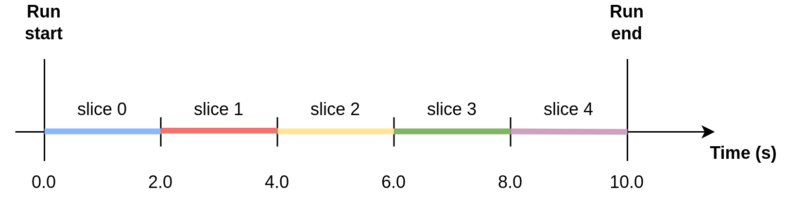
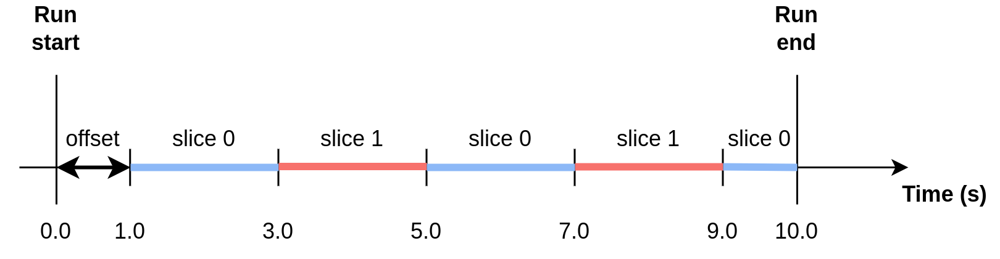
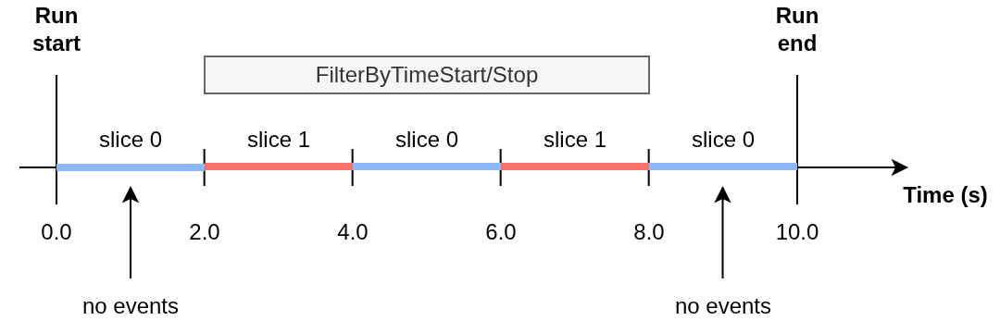

.. _user.slicing:

Slicing
=======

The user can perform slicing of a data set by either time or sample log (but not both). Data
reduction is performed separately on each slice according to the specified reduction parameters.
The output files will have a slice index appended to the configured ``"outputFileName"``, e.g.
``myFileName_0_Iq.dat``, ``myFileName_1_Iq.dat``, etc.

For EQSANS run in frame-skip mode, each frame will have its own time slices.
Thus, output files will also contain the frame index, e.g.
``myFileName_0_frame_0_Iq.dat`` and ``myFileName_0_frame_1_Iq.dat``.
If wedge binning is selected, the wedge label appears between the slice and frame labels,
e.g. ``myFileName_0_wedge_0_frame_0_Iq.dat``. PNG plot filenames follow the
same convention as the corresponding reduced data files.

.. contents:: Contents
   :local:

Time Slicing
------------

The user can specify time slicing to slice a run by time intervals and, optionally, a time period.
The following parameters specify the time slicing:

.. code-block:: json

    {
        "useTimeSlice": true,
        "timeSliceInterval": 4800,
        "timeSliceOffset": 0.0,
        "timeSlicePeriod": null,
    }

Example 1: Slicing using time interval
++++++++++++++++++++++++++++++++++++++

.. code-block:: json

    {
        "useTimeSlice": true,
        "timeSliceInterval": 2.0,
        "timeSliceOffset": 0.0,
        "timeSlicePeriod": null,
    }

Example 2: Slicing using time interval and offset
+++++++++++++++++++++++++++++++++++++++++++++++++

.. code-block:: json

    {
        "useTimeSlice": true,
        "timeSliceInterval": 2.0,
        "timeSliceOffset": 1.0,
        "timeSlicePeriod": null,
    }

.. figure:: media/time_slicing_offset.png
   :alt: Diagram of time slicing using an interval and offset
   :width: 800px

Events recorded before ``timeSliceOffset`` (here 0-1 s) are discarded. When the remaining run is not an
exact multiple of ``timeSliceInterval``, the last slice is shorter (here slice 4, from 9 s to 10 s).

Example 3: Slicing using time slice period
++++++++++++++++++++++++++++++++++++++++++

When using a time slice period, slices for a given time interval are reduced together.
In the figure, red slices are reduced together, and blue slices are reduced together.

.. code-block:: json

    {
        "useTimeSlice": true,
        "timeSliceInterval": 2.0,
        "timeSliceOffset": 0.0,
        "timeSlicePeriod": 4.0,
    }

.. figure:: media/time_slicing_period.png
   :alt: Diagram of time slicing using an interval and a period
   :width: 800px

The offset also applies to periodic slicing. With ``"timeSliceOffset": 1.0`` and the same interval and
period, the first period starts at 1 s and the last window (9-10 s) is shorter:

.. code-block:: json

    {
        "useTimeSlice": true,
        "timeSliceInterval": 2.0,
        "timeSliceOffset": 1.0,
        "timeSlicePeriod": 4.0,
    }

Note: if the period is not an integer multiple of the time slice interval, then the remainder of each period
forms its last, shorter slice. In the example below, each period holds two 3 second slices, then one
2 second slice.

.. code-block:: json

    {
        "useTimeSlice": true,
        "timeSliceInterval": 3.0,
        "timeSliceOffset": 0.0,
        "timeSlicePeriod": 8.0,
    }

Example 4: Time slicing and event filtering during loading
++++++++++++++++++++++++++++++++++++++++++++++++++++++++++

The time slicing parameters are applied relative to the whole data from the beginning to the end of
the run, independent of any event filtering during loading (i.e. using the parameter
``"loadOptions"``).

This example shows EQSANS (SNS time-of-flight instrument) configuration:

.. code-block:: json

    {
        "sample": {
            "loadOptions": {"FilterByTimeStart": 2.0, "FilterByTimeStop": 8.71}
        },
        "configuration": {
            "useTimeSlice": true,
            "timeSliceInterval": 2.0,
            "timeSliceOffset": 0.0,
            "timeSlicePeriod": 4.0,
        }
    }

Event Filtering for BIOSANS and GPSANS
++++++++++++++++++++++++++++++++++++++++

BIOSANS and GPSANS (HFIR monochromatic instruments) also support event filtering using
``loadOptions``. The same ``FilterByTimeStart`` and ``FilterByTimeStop`` parameters can be used
to filter events before reduction.

Example for BIOSANS or GPSANS:

.. code-block:: json

    {
        "instrumentName": "BIOSANS",
        "sample": {
            "runNumber": "1322",
            "loadOptions": {"FilterByTimeStart": 10.0, "FilterByTimeStop": 300.0}
        }
    }

As for EQSANS (Example 4), the load-time cutoffs and the time slices are independent. Events outside
``FilterByTimeStart`` and ``FilterByTimeStop`` are discarded during loading, but the slices still start at
``timeSliceOffset`` after the run start, whatever the value of ``FilterByTimeStart``. Slices that fall
outside the cutoffs hold no events; see `Empty and partially filled slices`_.

.. note::
   The ``FilterByTimeStart`` and ``FilterByTimeStop`` parameters specify times in seconds relative
   to the start of the run. With time slicing, these options are passed to ``LoadEventNexus`` for all
   instruments. Without time slicing, they are passed to ``LoadEventAsWorkspace2D`` for HFIR instruments
   (BIOSANS and GPSANS) and to ``LoadEventNexus`` for EQSANS.

Empty and partially filled slices
+++++++++++++++++++++++++++++++++

Slices that hold no events, because they fall outside the load-time cutoffs or during a period without
beam, are dropped and not reduced. The output suffix (``_0``, ``_1``, ...) counts only the remaining
slices, so ``_0`` is not necessarily the first time window of the run.

A slice that straddles a cutoff keeps only part of its window. Its ``duration`` and ``proton_charge``
sample logs cover only the time it actually holds, so the normalization uses its actual exposure.

In the example below, a 60 s run is sliced every 10 s and only the events after 25 s are loaded. The windows
0-10 s and 10-20 s are dropped. The window 20-30 s, which holds the events from 25 s to 30 s, is written
with suffix ``_0``, and the windows 30-40 s, 40-50 s and 50-60 s with suffixes ``_1``, ``_2`` and ``_3``.

.. code-block:: json

    {
        "sample": {
            "loadOptions": {"FilterByTimeStart": 25.0}
        },
        "configuration": {
            "useTimeSlice": true,
            "timeSliceInterval": 10.0,
            "timeSliceOffset": 0.0,
            "timeSlicePeriod": null,
        }
    }

.. figure:: media/time_slicing_empty_slices.png
   :alt: Diagram of time slicing with empty slices removed
   :width: 800px

With periodic slicing, an empty window does not remove a slice, because each slice also collects the events
of the same window in the other periods. In the figure of Example 4, the empty window 0-2 s belongs to slice 0,
which still holds the events recorded from 4 s to 6 s and from 8 s to 8.71 s.

Slice metadata
++++++++++++++

Each slice receives the following sample logs:

.. list-table::
   :header-rows: 1
   :widths: 25 75

   * - Sample log
     - Meaning
   * - ``slice_start``, ``slice_end``
     - Time slicing: start and end of the slice's window, in seconds from the run start. This is the full
       window even when the slice is only partly filled, and the last slice may end slightly after the run end.
       Periodic slicing: start and end of the window, in seconds from the start of each period. Log slicing: lower and upper
       values of the sample log, in the log's units.
   * - ``slice_interval``
     - Time and periodic slicing: the value of ``timeSliceInterval``, in seconds. Log slicing: the
       log-value interval.
   * - ``slice_period``
     - The value of ``timeSlicePeriod``, in seconds (periodic slicing only).
   * - ``slice_parameter``
     - ``relative time from start`` (time slicing), ``periodic time from start`` (periodic slicing), or the
       name of the sample log (log slicing).
   * - ``slice``, ``number_of_slices``
     - Position of the slice, counting from 1, and number of slices. Both count only the remaining slices.
   * - ``duration``
     - The exposure the slice actually covers, in seconds.

To place a slice in time, use ``slice_start`` and ``slice_end``, not the output suffix.

Log Slicing
-----------

Log slicing refers to slicing by the value of a `sample log
<https://docs.mantidproject.org/nightly/tutorials/mantid_basic_course/connecting_data_to_instruments/06_sample_logs.html>`_
in the NeXus file corresponding to the sample run.

.. code-block:: json

    {
        "useLogSlice": true,
        "logSliceName": "MySampleLog",
        "logSliceInterval": 200.0,
    }

Example: Log slicing using log "Temperature"
++++++++++++++++++++++++++++++++++++++++++++

.. code-block:: json

    {
        "useLogSlice": true,
        "logSliceName": "Temperature",
        "logSliceInterval": 10.0,
    }

.. figure:: media/log_slicing_interval.png
   :alt: Diagram of log slicing
   :width: 800px

Slicing and Error-Weighted Binning
----------------------------------

Note that using error-weighted averaging in combination with slicing may result in disparity
between time sliced and non-time sliced data if there is not enough data in the slices for the
error distribution to converge.

.. code-block:: json

    {
        "useErrorWeighting": true,
    }

Figure 1 compares I(Q) for the whole run (blue dot markers) to I(Q) for time slices
of the data (solid lines) for the time slice intervals 600 s, 1200 s, 2400 s and 4800 s. The time
sliced I(Q) converges to the total I(Q) with increasing time slice interval.

.. figure:: media/AlCell_He_1bar_timeslice_vs_no_timeslice.png
   :alt: I(Q) with and without time slicing for different time slice intervals using error-weighted averaging.
   :width: 800px

   Figure 1: I(Q) for time slices of a run compared to the total run for different time slice intervals and
   with error-weighted averaging (``"useErrorWeighting": true``).

In Figure 2, the same comparison between time sliced and non-time sliced data but with
error-weighted averaging turned off (i.e. using arithmetic averaging) shows no dependence on the
time slice interval.

.. figure:: media/AlCell_He_1bar_timeslice_vs_no_timeslice_no_error_weighting.png
   :alt: I(Q) with and without time slicing for different time slice intervals using arithmetic averaging.
   :width: 800px

   Figure 2: I(Q) for time slices of a run compared to the total run for different time slice intervals and
   with error-weighted averaging (``"useErrorWeighting": false``).
